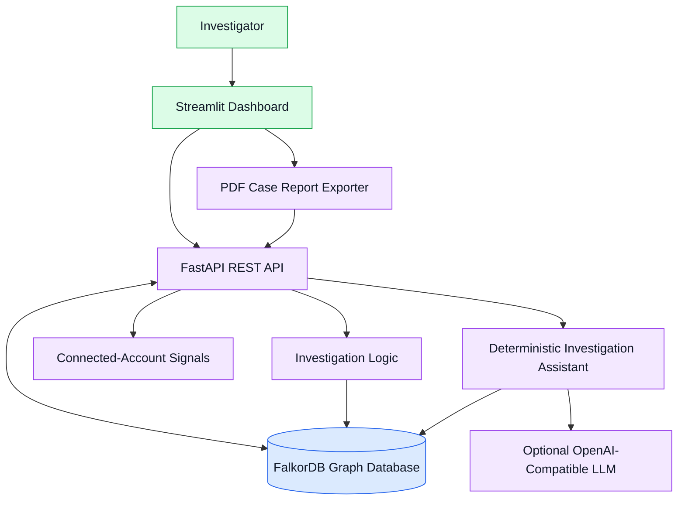
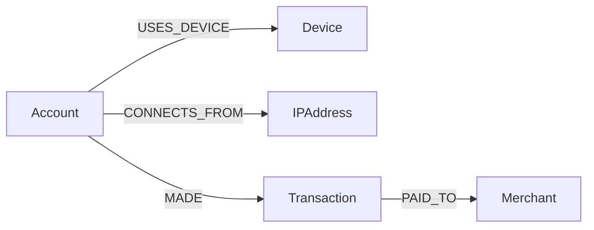

# FraudTrace AI
### Graph-Powered Fraud Investigation with FalkorDB

**Connect the evidence. Investigate the pattern. Keep the decision human.**

**Live application:** [Open FraudTrace AI](https://fraudtrace-ai-r6hopnhtksi98bbtrsublj.streamlit.app/)<br>
**Backend health:** [Check API health](https://fraudtrace-ai-backend.onrender.com/health)<br>
**Source repository:** [gagan-gag/FraudTrace-AI](https://github.com/gagan-gag/FraudTrace-AI)

FraudTrace AI is a graph-powered investigation platform designed to help analysts explore suspicious transaction activity, identify relationships between accounts, inspect connected entities, and generate structured case reports. It supports two separate synthetic datasets: the FraudTrace demonstration graph and IBM AMLSim simulation data.

Instead of examining transactions in isolation, FraudTrace AI uses **FalkorDB** to represent and traverse relationships between accounts, devices, IP addresses, transactions, merchants, branches, and AML alerts where those entities exist in the selected dataset.

Investigators can explore graph neighborhoods, review supporting evidence, receive deterministic or optionally language-model-assisted summaries, and export PDF reports.

> **Important:** Both included datasets are synthetic: the FraudTrace demonstration data and the IBM AMLSim simulation data. Investigation findings are leads for human review, not proof of fraud. The assistant retrieves graph evidence and uses deterministic question routing, with optional OpenAI-compatible language-model answering when configured. Model-generated responses may be incorrect; verify claims against the supporting evidence.

---

## Table of Contents

- [Problem Statement](#problem-statement)
- [Solution](#solution)
- [Key Features](#key-features)
- [Multi-Dataset Architecture](#multi-dataset-architecture)
- [System Architecture](#system-architecture)
- [Technology Stack](#technology-stack)
- [Graph Data Model](#graph-data-model)
- [Example Cypher Queries](#example-cypher-queries)
- [Project Structure](#project-structure)
- [Installation and Setup](#installation-and-setup)
- [Port Configuration & Conflict Troubleshooting](#port-configuration--conflict-troubleshooting)
- [Running the Application](#running-the-application)
- [API Reference](#api-reference)
- [Testing](#testing)
- [Example Investigation](#example-investigation)
- [Responsible Use and Limitations](#responsible-use-and-limitations)
- [Future Improvements](#future-improvements)
- [Acknowledgements](#acknowledgements)

---

## Problem Statement

Fraud investigations can become difficult when evidence is distributed across multiple accounts, transactions, devices, IP addresses, and merchants.

Reviewing individual transactions may not immediately reveal relationships that deserve further investigation.

For example:

- Multiple accounts may use the same device.
- Different accounts may connect through the same IP address.
- Several transactions may be associated with a common merchant.
- A relationship discovered through one account may lead investigators to other connected entities.

These connections do not necessarily indicate fraudulent activity. However, they can help investigators identify patterns that warrant closer examination.

## Solution

FraudTrace AI represents investigation data as a graph and uses FalkorDB to explore connections between entities.

The application provides an investigation workflow in which a user can:

1. Select an account for investigation.
2. Retrieve connected-account and transaction evidence.
3. Explore related entities through bounded graph traversal.
4. Inspect shared-device, shared-IP, and merchant signals.
5. Ask the deterministic investigation assistant for an evidence-based summary.
6. Generate a PDF case report for review.

The goal is to make connected evidence easier to explore and explain while keeping final decisions with human investigators.

---

## Key Features

### 1. Graph-Powered Investigation with FalkorDB
Uses FalkorDB to store entities and relationships and retrieve connected graph neighborhoods.

### 2. Interactive Graph Visualization
Uses Plotly and NetworkX to display graph entities and relationships with interactive 2D force-directed and 3D layouts, including zoom, pan, focus selection, and entity filters.

### 3. Multi-Hop Path Finder
Discovers and traces paths between entities in FalkorDB (e.g. Account → Device → Account, Account → IPAddress → Account, Account → Transaction → Merchant) with ordered step visualization and supporting evidence references.

### 4. Connected-Account Clusters
Finds connected account groups using dataset-specific relationships and reports heuristic review priorities. These priorities are not calibrated fraud probabilities.

### 5. Connected-Account Signals
Identifies shared-device, shared-IP, and shared-merchant relationships in the demo graph; AMLSim uses transaction counterparties and alerts. Review priorities are heuristic labels (HIGH, MEDIUM, REVIEW).

### 6. Transaction Evidence
Retrieves transaction details, merchant associations, amounts, and transaction status with UTF-8 safe currency formatting.

### 7. Evidence-Grounded Investigation Assistant
Produces structured investigation summaries using available graph evidence, with deterministic question routing, stable evidence references (`EV-LINK-...`, `EV-TXN-...`), and persistent case memory.

### 8. Persistent Case Memory (Track 02)
Stores investigation observations in FalkorDB linked to accounts (`:HAS_INVESTIGATION_MEMORY`), enabling cross-session recall and search across sessions.

### 9. PDF Case Report Generation
Exports investigation findings, related accounts, transaction evidence, graph details, assistant output, and report notes into a PDF for review. The report is not certified forensic evidence and is not represented as court-ready.

### 10. Multi-Dataset Support & Dataset Isolation
Allows switching between the FraudTrace synthetic demonstration graph (`demo_synthetic`, graph `FraudTrace`) and IBM AMLSim synthetic simulation data (`ibm_amlsim`, graph `ibm_amlsim`). A server-side allowlist selects the supported graph for each request; dataset-isolation tests cover separation between the two graphs.

### 11. Automated Test Suite
Includes unit, graph-isolation, AMLSim import, PDF report, and API smoke checks.

---

## Multi-Dataset Architecture

FraudTrace AI supports two distinct graph datasets simultaneously:

| Dataset ID | Graph Name | Focus & Characteristics | Key Entities & Labels | Recommended Starting Account |
|---|---|---|---|---|
| `demo_synthetic` | `FraudTrace` | Synthetic fraud ring with shared infrastructure signals | `Account`, `Device`, `IPAddress`, `Merchant`, `Transaction` | `ACC002` (Shares device with `ACC001`) |
| `ibm_amlsim` | `ibm_amlsim` | Synthetic IBM AMLSim simulation with transfers, cash activity, branches, and alerts; not real-world transactions | `AMLAccount`, `AMLTransaction`, `AMLAlert`, `AMLBranch` | `AML_ACC_25` (linked to alert `AML_ALERT_0`) |

### Dataset distinctions
1. **Dataset selection**: The API validates dataset IDs against its allowlist before selecting the corresponding graph. Arbitrary graph names are rejected.
2. **Schema preservation**: AMLSim does not contain device, IP, or merchant entities. Transfers use `AML_SENT` and `AML_RECEIVED`; cash transactions can link to an `AMLBranch` using `AML_AT_BRANCH`; alerts link to accounts using `HAS_ALERT`.
3. **Source evidence**: The importer preserves AMLSim alert source fields. The API derives a separate readable `display_description` from the check name without replacing `alert_text`, `check_name`, or `pattern`.
4. **Simulation labels**: AMLSim `is_fraud` and `suspicious` values are source account labels in a simulation, not confirmed real-world findings or transaction-level flags.

---

## System Architecture

The following diagram represents the high-level application architecture.



### Component Responsibilities

| Component | Responsibility |
|---|---|
| Streamlit dashboard | Investigation interface, graph exploration, evidence presentation, and report download |
| FastAPI | REST endpoints, request validation, and investigation responses |
| FalkorDB | Graph storage and relationship traversal |
| Investigation logic | Collects connected-account and transaction evidence |
| Connected-account signals | Evaluates relationships available in the selected dataset |
| Investigation assistant | Routes questions to evidence retrieval and returns a deterministic summary or optional language-model answer |
| PDF exporter | Requests investigation data from the API and generates a structured report |

FalkorDB is central to the solution because the investigation depends on relationships between entities, rather than only on isolated transaction records.

---

## Technology Stack

| Component | Technology |
|---|---|
| Language | Python |
| Graph database | FalkorDB |
| Backend API | FastAPI |
| Request validation | Pydantic |
| Dashboard | Streamlit |
| Graph visualization | Plotly and NetworkX |
| Data presentation | Pandas |
| PDF generation | ReportLab |
| HTTP client | Requests |
| Optional language-model provider | OpenAI-compatible chat completions API |
| Automated testing | Python `unittest` test modules and API smoke-test scripts |
| Local database runtime | Docker |

---

## Graph Data Model

FraudTrace AI uses five principal node types.

### Node Types

| Node label | Description | Example |
|---|---|---|
| `Account` | Represents an account under investigation | `ACC002` |
| `Device` | Represents a device associated with an account | `DEV002` |
| `IPAddress` | Represents an IP address associated with an account | `IP002` |
| `Transaction` | Represents a transaction | `TXN002` |
| `Merchant` | Represents a merchant receiving a transaction | `MER001` |

### Relationships

| Relationship | Direction | Description |
|---|---|---|
| `USES_DEVICE` | Account → Device | An account is associated with a device |
| `CONNECTS_FROM` | Account → IPAddress | An account is associated with an IP address |
| `MADE` | Account → Transaction | An account made a transaction |
| `PAID_TO` | Transaction → Merchant | A transaction is associated with a merchant |

### Graph Structure



The graph model makes it possible to traverse from an investigated account to related infrastructure, transactions, and merchants.

### IBM AMLSim graph

| Node label | Relationships |
|---|---|
| `AMLAccount` | `AML_SENT` to outgoing transactions; `HAS_ALERT` to linked alerts |
| `AMLTransaction` | `AML_RECEIVED` to recipient accounts when present; `AML_AT_BRANCH` to branch nodes for cash activity |
| `AMLAlert` | Linked to its source account by `HAS_ALERT`; retains source alert text, check name, and pattern |
| `AMLBranch` | Connected to cash transactions by `AML_AT_BRANCH` |

AMLSim transaction statuses are read from the transaction record. Account-level `is_fraud` or `suspicious` labels do not, by themselves, mark a transaction as flagged.

### Example Investigation Pattern

An investigation may reveal that two accounts share a device. A further traversal may reveal that one of those accounts shares an IP address with another account.

Such paths can provide useful investigation leads, but they do not establish shared ownership, intent, or criminal activity.

---

## Example Cypher Queries

The following queries illustrate how FalkorDB can support the investigation workflow. They are examples of the graph model, not a guarantee that every query is executed verbatim by the application's endpoints.

### 1. Find accounts sharing a device

```cypher
MATCH (a:Account)-[:USES_DEVICE]->(d:Device)<-[:USES_DEVICE]-(other:Account)
WHERE a.id = $account_id
  AND other.id <> a.id
RETURN
    a.id AS investigated_account,
    d.id AS shared_device,
    other.id AS connected_account
```

### 2. Find accounts sharing an IP address

```cypher
MATCH (a:Account)-[:CONNECTS_FROM]->(ip:IPAddress)<-[:CONNECTS_FROM]-(other:Account)
WHERE a.id = $account_id
  AND other.id <> a.id
RETURN
    a.id AS investigated_account,
    ip.id AS shared_ip,
    other.id AS connected_account
```

### 3. Retrieve transaction and merchant evidence

```cypher
MATCH (a:Account)-[:MADE]->(t:Transaction)-[:PAID_TO]->(m:Merchant)
WHERE a.id = $account_id
RETURN
    a.id AS account_id,
    t.id AS transaction_id,
    t.amount AS amount,
    t.status AS status,
    m.id AS merchant_id
```

### 4. Explore a bounded graph neighborhood

```cypher
MATCH (root:Account {id: $account_id})
MATCH path = (root)-[*1..3]-(neighbor)
WHERE length(path) <= $hops
RETURN path
```

The `/graph/{account_id}` API limits neighborhood depth to 1–3. The separate `/paths` endpoint supports path searches of 1–6 hops.

---

## Project Structure

```text
FraudTrace AI/
├── app.py                      # FastAPI REST application
├── dashboard.py                # Streamlit graph investigation dashboard
├── dataset_registry.py         # Multi-dataset allowlist and registry
├── amlsim_importer.py          # IBM AMLSim CSV graph importer
├── amlsim_data/                # AMLSim CSV source data (accounts, tx, cash_tx, alerts)
├── seed_graph.py               # Synthetic demo graph initialization
├── inspect_graph.py            # Graph exploration and Cypher inspector
├── investigate.py              # Account investigation and risk scoring
├── ring_detection.py           # Multi-hop paths & cluster detection
├── case_memory.py              # Persistent case memory module (Track 02)
├── ai_assistant.py             # Grounded AI investigation assistant
├── export_case_report.py       # PDF case dossier report generator
├── smoke_test.py               # API smoke checks (writes and removes a temporary case memory)
├── test_case_memory.py         # Graph-backed case-memory tests
├── test_case_report.py         # PDF report formatting tests
├── test_enhanced_features.py   # Graph-backed path, cluster, and evidence tests
├── test_amlsim_importer.py     # AMLSim parsing and importer tests
├── test_dataset_isolation.py   # Graph-backed dataset isolation tests
├── test_falkordb.py            # FalkorDB connectivity test (creates test graph data)
├── requirements.txt            # Python dependencies
├── README.md                   # Full system documentation
└── reports/                    # Generated sample report output
```

The `reports/` directory may contain generated demonstration output. Confirm that any report is synthetic and appropriate for publication before sharing it.

---

## Installation and Setup

### Prerequisites

Install the following before running the project:

- Python
- Docker Desktop
- Git
- A terminal such as Windows PowerShell

### 1. Clone the repository

```powershell
git clone https://github.com/gagan-gag/FraudTrace-AI.git
cd FraudTrace-AI
```

### 2. Create and activate a virtual environment

```powershell
python -m venv .venv
.\.venv\Scripts\Activate.ps1
python -m pip install --upgrade pip
```

If PowerShell prevents activation, consult the Python documentation for virtual-environment activation on Windows.

### 3. Install dependencies

```powershell
python -m pip install -r requirements.txt
```

### 4. Start FalkorDB

FraudTrace AI expects FalkorDB running locally on port `6379`.

If you do not already have a container named `falkordb`, create one:

```powershell
docker run -d --name falkordb -p 6379:6379 -p 3001:3000 falkordb/falkordb:latest
```

If the container already exists (or after a reboot), simply start it:

```powershell
docker start falkordb
```

Verify that the container is running:

```powershell
docker ps --filter "name=falkordb"
```

### 5. Initialize local demonstration datasets

FraudTrace AI includes two graphs:

1. **Synthetic Demo Graph (`FraudTrace`)**:
   ```powershell
   python seed_graph.py
   ```
   > **Destructive:** `seed_graph.py` deletes every node in the `FraudTrace` graph before recreating the sample graph. Only run it against a disposable local development graph after confirming the configured database target. Never run it against shared or production data.

2. **IBM AMLSim Graph (`ibm_amlsim`)**:
   ```powershell
   python amlsim_importer.py --dry-run
   ```
   The dry run validates and counts records without writing to FalkorDB. To import, run `python amlsim_importer.py` only after confirming the configured database is a disposable/local development database; the importer writes or updates AMLSim nodes and relationships.

### Environment variables

Set configuration in the process environment or a local `.env` file. `.env` is ignored by Git; do not commit credential values.

| Variable | Used by | Purpose |
|---|---|---|
| `FALKORDB_HOST`, `FALKORDB_PORT` | Backend | FalkorDB connection; defaults to local host and port |
| `FALKORDB_USERNAME`, `FALKORDB_PASSWORD` | Backend | Optional FalkorDB authentication |
| `API_BASE_URL` | Dashboard and API scripts | Backend base URL; dashboard defaults to the hosted Render backend, while API scripts default to local FastAPI |
| `FRAUDTRACE_IMPORT_API_KEY` | Backend only | Required bearer secret for `POST /import-amlsim`; no default |
| `FRAUDTRACE_LLM_API_KEY` or `OPENAI_API_KEY` | Assistant | Optional provider credential; values must remain secret |
| `FRAUDTRACE_LLM_BASE_URL` | Assistant | Optional OpenAI-compatible API base URL |
| `FRAUDTRACE_LLM_MODEL` | Assistant | Optional model name |

The local `.env` file is loaded for development. Hosting-provider environment variables should be configured in the backend's secret/environment settings, not committed to this repository. Configure `FRAUDTRACE_IMPORT_API_KEY` as a unique, high-entropy secret (at least 32 random bytes); do not set it in the frontend. Keep a secure copy for authorized operators that need to run the import endpoint. The import endpoint fails closed with HTTP 503 if the backend key is missing. Deploy behind HTTPS, restrict access to the import endpoint to trusted operators where possible, and rotate the key through the secret manager if it may have been exposed. Never log the authorization header.

---

## Port Configuration & Conflict Troubleshooting

FraudTrace AI uses three local network ports:

| Service | Default Port | Environment Variable / Flag | Purpose |
|---|---|---|---|
| **FalkorDB** | `6379` | `FALKORDB_PORT=6379` | Graph database engine |
| **FastAPI Backend** | `8010` | `--port 8010` | REST API & Investigation engine |
| **Streamlit Dashboard** | `8501` | `--server.port 8501` | User interface & 3D visualization |

### Preventing and Resolving Port Conflicts

If you see an error like `[Errno 10048] error while attempting to bind on address ('127.0.0.1', 8010)` or Docker container name conflicts, use the following quick fixes:

#### 1. Port 8010 already in use (FastAPI backend)
A previous backend instance or terminal session may still be running in the background.

* **Find and kill process on port 8010 (PowerShell)**:
  ```powershell
  Get-NetTCPConnection -LocalPort 8010 -ErrorAction SilentlyContinue | ForEach-Object { Stop-Process -Id $_.OwningProcess -Force }
  ```
* **Or run on an alternate port**:
  ```powershell
  python -m uvicorn app:app --host 127.0.0.1 --port 8020
  ```

#### 2. Port 8501 already in use (Streamlit dashboard)
* **Kill existing Streamlit process (PowerShell)**:
  ```powershell
  Get-NetTCPConnection -LocalPort 8501 -ErrorAction SilentlyContinue | ForEach-Object { Stop-Process -Id $_.OwningProcess -Force }
  ```
* **Or let Streamlit pick another port**:
  ```powershell
  streamlit run dashboard.py --server.port 8502
  ```

#### 3. Docker Conflict: container name "/falkordb" is already in use
This occurs if you run `docker run` when the container was previously created.
* **Fix**: Run `docker start falkordb` instead of `docker run`.
* Recreating a container can remove its stored data. Only remove a disposable local development container after confirming it contains no data that must be retained:
  ```powershell
  docker rm -f falkordb
  docker run -d --name falkordb -p 6379:6379 -p 3001:3000 falkordb/falkordb:latest
  ```

---

## Running the Application

Follow these steps to launch the entire stack:

### Step 1: Start the FastAPI Backend (Terminal 1)

```powershell
# Run from the repository root
.\.venv\Scripts\Activate.ps1
python -m uvicorn app:app --host 127.0.0.1 --port 8010
```

Verify backend health by visiting:
- Health check: [http://127.0.0.1:8010/health](http://127.0.0.1:8010/health) (returns `{"status":"healthy","database":"FalkorDB","graphs":["FraudTrace","ibm_amlsim"]}`)
- Interactive Swagger docs: [http://127.0.0.1:8010/docs](http://127.0.0.1:8010/docs)

Keep this terminal running.

### Step 2: Start the Dashboard (Terminal 2)

```powershell
# Run from the repository root
.\.venv\Scripts\Activate.ps1
streamlit run dashboard.py
```

The Streamlit UI opens automatically in your browser at:
- Dashboard: [http://localhost:8501](http://localhost:8501)

The dashboard reads `API_BASE_URL` to locate FastAPI and defaults to `https://fraudtrace-ai-backend.onrender.com`. In the devcontainer, `API_BASE_URL` is set to `http://127.0.0.1:8010` so the dashboard targets a backend running locally in that container; Streamlit's CORS and XSRF protections remain at their secure defaults. For local PowerShell development outside the devcontainer, set `$env:API_BASE_URL = "http://127.0.0.1:8010"` before running `streamlit run dashboard.py`. For the hosted Streamlit dashboard, configure `API_BASE_URL` in the frontend provider's environment settings to `https://fraudtrace-ai-backend.onrender.com` (without a trailing slash). `API_BASE_URL` is a service URL, not a credential; keep backend secrets out of the frontend and configure FalkorDB credentials on the backend provider.

### Using the Multi-Dataset Dashboard
1. Use the **Dataset Selector** in the sidebar to switch between `FraudTrace AI Demo (Synthetic)` and `IBM AMLSim (Transaction Network)`.
2. Enter an account to investigate (`ACC002` for Demo; `AML_ACC_25` for AMLSim).
3. Click **Explore Graph** to load the selected account's graph.
4. Interact with the **AI Investigation Assistant** to explore suspicious patterns.
5. In **Reports**, use **Generate PDF Case Report** to create a structured investigation report. Report generation requests an assistant response and may save a case-memory observation.

---

## API Reference

| Method | Endpoint | Security class | Returned data / control |
|---|---|---|---|
| `GET` | `/` | Public metadata | Service name, version, and route list |
| `GET` | `/health` | Public operational metadata | Probes demo graph; exposes database type and configured graph names |
| `GET` | `/datasets` | Public metadata | Dataset schemas, descriptions, labels, graph names, and disclaimers |
| `GET` | `/dataset-stats/{dataset_id}` | Public aggregate metadata | Node/relationship counts; failures may include diagnostic details |
| `POST` | `/import-amlsim` | Backend bearer authentication | Requires backend-only `FRAUDTRACE_IMPORT_API_KEY`; non-dry-run modifies AMLSim graph |
| `GET` | `/investigate/{account_id}` | Public synthetic-demo investigation data | Risk/fraud labels, related account IDs, relationship signals, and evidence |
| `GET` | `/account-evidence/{account_id}` | Public synthetic-demo investigation data | Transactions, amounts, status, counterparties, alert/source fields |
| `GET` | `/graph/{account_id}` | Public filtered synthetic-demo graph | Bounded graph; memory nodes/edges excluded and properties filtered |
| `GET` | `/case-history/{account_id}` | Denied by default | Always returns HTTP 403 until verified identity and case grants exist |
| `POST` | `/ask` | Public synthetic-demo investigation data; rate/body limited | Returns current question, answer, evidence; saves memory but skips prior-memory reads |
| `GET` | `/paths` | Public filtered synthetic-demo graph | Path IDs/relationships; memory paths excluded and node properties filtered |
| `GET` | `/clusters` | Public synthetic-demo investigation data | Account groups, heuristic scores, flagged account/transaction IDs and relationships |
| `GET` | `/search` | Public filtered synthetic-demo graph | Entity matches; excludes memory nodes and filters properties |
| `GET`, `HEAD` | `/openapi.json`, `/docs`, `/docs/oauth2-redirect`, `/redoc` | Public API schema/docs | Documents the API; no user identity required |

"Public metadata" and "public filtered synthetic-demo graph" are intended for non-confidential demonstration data. "Public synthetic-demo investigation data" is visible to every caller and is not suitable for confidential information. "Backend bearer authentication" protects only the import operation; it does not authenticate dashboard users or authorize case access. "Denied by default" means there is no current authorized history path.

The allowlist contains `demo_synthetic` and `ibm_amlsim`, both described in this project as synthetic. That is a code/configuration constraint, not a guarantee about what operators may later load into those graph names. Never place real, personal, or otherwise confidential data in a publicly served graph.

`POST /ask` remains public for dashboard compatibility. It has a process-local rolling limit of 60 requests per 60 seconds (429 with `Retry-After`) and rejects bodies over 16 KiB (413) before assistant processing. Errors are sanitized. Because callers have no verified identity, `/ask` skips retrieval of previous persistent memories; it still returns the current caller's question/answer/evidence and saves a new observation. The client-provided session ID is not an identity credential. The in-memory limit is not distributed: multiple workers/instances have independent counters.

`/case-history` always returns 403 without querying FalkorDB. Existing memories are retained but not exposed by that endpoint. Public graph, path, and search routes exclude memory nodes and filter properties. Other routes intentionally expose investigation signals/evidence for the synthetic demo, so graph filtering does not make the service appropriate for confidential cases.

There is no end-user login, verified identity, or persistent case-to-user membership model. Before confidential use, implement server-side identity-provider token/session validation; persistent case membership records; owner/admin-controlled viewer and investigator grant/revocation workflows; and authorization checks on every endpoint returning case data. Existing cases need an explicit trusted ownership/membership migration. Do not infer permissions from account IDs, session IDs, arbitrary bearer headers, or static/shared frontend secrets.

Before staging, use an isolated disposable graph. Verify every route in this table, including arbitrary bearer headers on `/case-history`, graph/path/search filtering, disabled prior-memory retrieval in `/ask`, and import/rate/body protections. Do not use production credentials or sensitive data. Stage and test the complete identity/membership design separately before enabling confidential cases.
### Render staging and rollback

The repository does not contain Render service settings, so verify the service topology and environment in the Render dashboard rather than assuming a worker or instance count:

1. Open the [Render dashboard](https://dashboard.render.com/), select **Web Services**, and choose the backend whose service URL is `fraudtrace-ai-backend.onrender.com`.
2. Open **Environment** and add `FRAUDTRACE_IMPORT_API_KEY`. Generate a fresh 32-byte (256-bit) URL-safe random value locally in PowerShell without printing it:
   ```powershell
   $bytes = New-Object byte[] 32
   $rng = [System.Security.Cryptography.RandomNumberGenerator]::Create()
   $rng.GetBytes($bytes)
   $rng.Dispose()
   $token = [Convert]::ToBase64String($bytes).TrimEnd('=').Replace('+', '-').Replace('/', '_')
   Set-Clipboard -Value $token
   Remove-Variable bytes, token, rng
   ```
   Paste the clipboard value directly into the backend secret field, save the environment, then clear the clipboard with `Set-Clipboard -Value ''`. Do not add the key to the Streamlit service or repository. Saving environment changes may restart or redeploy the backend; verify the service status afterward.
3. Confirm the service uses HTTPS. In **Settings**, inspect the start command for Uvicorn worker arguments and check the service's instance/scaling configuration. Keep the deployment to one worker and one instance to use the documented local counter as intended. If using multiple workers or instances, configure and verify an edge/shared-store limiter first; this application has no shared rate-limit store.
4. Deploy and test the change in a staging service connected only to a disposable, isolated FalkorDB database. Do not point staging at production credentials or graphs. Verify normal dashboard flows, public graph filtering, disabled case-history behavior, import authorization, request limits, oversized requests, and error responses before promoting the revision. Do not use sensitive data; end-user case authorization is not implemented.
5. For rollback, choose a previously reviewed deployment that still enforces `/import-amlsim` bearer authentication and preserve the backend secret environment variable. Do not roll back to a revision without import authentication unless `/import-amlsim` is first disabled or blocked at the hosting edge. Recheck service health and logs after the rollback; do not use `/ask` or the importer as a health probe.

For an authorized manual import, send the bearer token from a trusted operator environment. For example, in PowerShell, once the secret is set in the current process environment:

```powershell
Invoke-RestMethod -Method Post `
  -Uri "https://<backend-host>/import-amlsim?dry_run=true" `
  -Headers @{ Authorization = "Bearer $env:FRAUDTRACE_IMPORT_API_KEY" }
```

Use `dry_run=true` to validate without graph writes. A request without `dry_run=true` changes the AMLSim graph; run it only when an authorized import is intended. Do not put the token in the dashboard, source control, command-line literals, or logs.

### Example Graph Request

```text
GET /graph/ACC002?hops=3&dataset=demo_synthetic
```

Or for the IBM AMLSim dataset:

```text
GET /graph/AML_ACC_25?hops=2&dataset=ibm_amlsim
```

### Example Assistant Request

```json
{
  "account_id": "AML_ACC_25",
  "question": "What alerts and transactions are associated with this account?",
  "dataset_id": "ibm_amlsim"
}
```

The assistant endpoint returns a structured response with the account, question, answer, evidence references, and responsible-use notice. It also writes an investigation-memory observation to the selected graph. The `/health` endpoint queries the demo graph and reports the configured graph names; it does not independently prove that every dataset graph contains data.

For interactive schema inspection, use the Swagger UI at [http://127.0.0.1:8010/docs](http://127.0.0.1:8010/docs).

---

## Testing

### Focused tests without live graph writes

```powershell
.\.venv\Scripts\python.exe -m unittest test_case_report -v
.\.venv\Scripts\python.exe -m unittest test_amlsim_importer.AMLSimImporterTests.test_fraud_labels_do_not_flag_simulated_transactions -v
.\.venv\Scripts\python.exe -m unittest test_api_security -v
.\.venv\Scripts\python.exe -m unittest test_assistant_safety -v
```

### Full graph-backed test suite

```powershell
.\.venv\Scripts\python.exe -m unittest discover -s . -p "test_*.py" -v
```

The full suite includes graph-backed tests that create and remove nodes, and an importer test that writes AMLSim data. Run it only against a dedicated disposable local FalkorDB database containing the expected seed graphs, never against production or shared data.

### API smoke checks

```powershell
.\.venv\Scripts\python.exe smoke_test.py
```

The smoke check requires a running backend and seeded demo graph. It posts an assistant request, which temporarily writes a case-memory node, and then attempts to delete that test node. `verify_amlsim_api.py` similarly posts an assistant request and removes a temporary AMLSim memory. Use these scripts only against a dedicated disposable test database; setting `API_BASE_URL` to a hosted backend does not make their writes safe.

---

## Example Investigation

The `demo_synthetic` dataset contains accounts, devices, IP addresses, transactions, and merchants.

For the synthetic walkthrough, investigate `ACC002`. The seeded example graph links it to `ACC001`, `ACC003`, and `ACC006` through shared entities, and its transaction evidence includes `TXN002` with a flagged status. In the IBM AMLSim dataset, `AML_ACC_25` is linked to alert `AML_ALERT_0`; its readable display description is derived from the check name while the source alert text remains available separately.

Use the graph and evidence panels to inspect these relationships, then compare the corresponding source evidence. The application presents them as investigation leads, not conclusions.

**Interpretation matters:** these values describe the synthetic example, not an observed real-world fraud incident. A flagged status and a shared infrastructure relationship are not proof of wrongdoing.

---

## Responsible Use and Limitations

FraudTrace AI is an investigation-support demonstration.

- **Synthetic data:** Both available datasets are simulations; AMLSim data is not real-world financial activity.
- **No conclusive fraud determination:** A flagged transaction is a review signal, not proof of fraud.
- **Shared infrastructure:** Legitimate accounts may share devices, networks, and merchants.
- **Heuristic priorities:** Review priorities are not calibrated fraud probabilities.
- **Evidence-grounded assistant:** The assistant uses deterministic question routing and retrieved graph evidence, with optional OpenAI-compatible language-model answering when configured. Model-generated responses may be incorrect; verify claims against the returned evidence references.
- **No claimed real-world accuracy:** No real-world precision, recall, false-positive rate, or financial-loss reduction claim is made.
- **Human oversight:** Investigators should verify source records, consider alternative explanations, and follow appropriate review procedures.

Production use would require representative data, privacy and access controls, auditability, security testing, evaluation on held-out data, and a documented human-review process.

---

## Future Improvements

Potential future work includes:

- More readable graph-path visualization and relationship highlighting.
- Improved PDF layout and visual summaries of multi-hop paths.
- Reproducible clean-environment installation and automated integration testing.
- More extensive graph investigation scenarios and evaluation datasets.
- Clearer presentation of graph-path evidence and report contents.
- Security, privacy, access control, and audit capabilities for a production deployment.
- Evaluation using representative, appropriately governed data before making performance claims.

These are proposed improvements, not claims about features already implemented.

---

## AI-Assisted Development Disclosure

AI coding assistance was used during development to help review code, improve documentation, troubleshoot issues, and refine implementation details. The project author is responsible for understanding, validating, and explaining the submitted implementation, graph model, queries, and technical decisions.

---

## Acknowledgements

Built for the WeMakeDevs × FalkorDB Graph Hacks. The synthetic AML network is based on the [IBM AMLSim project](https://github.com/IBM/AMLSim); FalkorDB provides the graph database used by this application.

**FraudTrace AI — connect the evidence, investigate the pattern, and keep the decision human.**
