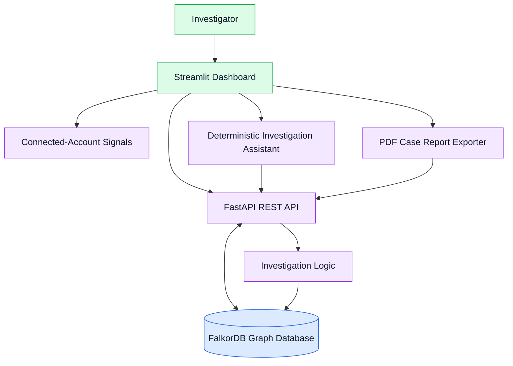
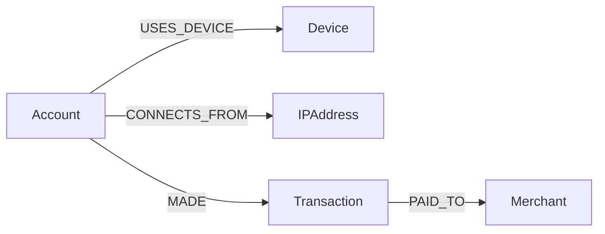

# FraudTrace AI
### Graph-Powered Fraud Investigation with FalkorDB

**Connect the evidence. Investigate the pattern. Keep the decision human.**

FraudTrace AI is a graph-powered investigation platform designed to help analysts explore suspicious transaction activity, identify relationships between accounts, inspect connected infrastructure, and generate structured case reports.

Instead of examining transactions in isolation, FraudTrace AI uses **FalkorDB** to represent and traverse relationships between accounts, devices, IP addresses, transactions, and merchants.

Investigators can explore graph neighborhoods at different depths, review supporting evidence, receive deterministic investigation summaries, and export PDF reports.

> **Important:** This project uses synthetic demonstration data. Investigation findings are leads for human review, not proof of fraud. The assistant retrieves graph evidence and uses deterministic question routing, with optional Groq/OpenAI-compatible language-model answering when configured. Model-generated responses may be incorrect; verify claims against the supporting evidence.

---

## Table of Contents

- [Problem Statement](#problem-statement)
- [Solution](#solution)
- [Key Features](#key-features)
- [System Architecture](#system-architecture)
- [Technology Stack](#technology-stack)
- [Graph Data Model](#graph-data-model)
- [Example Cypher Queries](#example-cypher-queries)
- [Project Structure](#project-structure)
- [Installation and Setup](#installation-and-setup)
- [Running the Application](#running-the-application)
- [API Reference](#api-reference)
- [Testing](#testing)
- [Example Investigation](#example-investigation)
- [Responsible Use and Limitations](#responsible-use-and-limitations)
- [Demo Walkthrough](#demo-walkthrough)
- [Hackathon Submission Checklist](#hackathon-submission-checklist)
- [Future Improvements](#future-improvements)
- [Acknowledgements](#acknowledgements)

---

## Problem Statement

Fraud investigations can become difficult when evidence is distributed across multiple accounts, transactions, devices, IP addresses, and merchants.

Reviewing individual transactions may not immediately reveal relationships that deserve further investigation.

For example:

- Multiple accounts may use the same device.
- Different accounts may connect through the same IP address.
- Several transactions may be associated with a common merchant.
- A relationship discovered through one account may lead investigators to other connected entities.

These connections do not necessarily indicate fraudulent activity. However, they can help investigators identify patterns that warrant closer examination.

## Solution

FraudTrace AI represents investigation data as a graph and uses FalkorDB to explore connections between entities.

The application provides an investigation workflow in which a user can:

1. Select an account for investigation.
2. Retrieve connected-account and transaction evidence.
3. Explore related entities through bounded graph traversal.
4. Inspect shared-device, shared-IP, and merchant signals.
5. Ask the deterministic investigation assistant for an evidence-based summary.
6. Generate a PDF case report for review.

The goal is to make connected evidence easier to explore and explain while keeping final decisions with human investigators.

---

## Key Features

### 1. Graph-powered investigation

Uses FalkorDB to store entities and relationships and retrieve connected graph neighborhoods.

### 2. Multi-hop graph exploration

Supports graph traversal depths of 1, 2, and 3 through the investigation API.

### 3. Connected-account signals

Identifies relationships involving shared devices, IP addresses, and merchants.

### 4. Transaction evidence

Retrieves transaction details, merchant associations, amounts, and transaction status.

### 5. Interactive dashboard

Provides a Streamlit interface for selecting accounts, exploring evidence, viewing graph relationships, and interacting with the investigation assistant.

### 6. Evidence-grounded investigation assistant

Produces structured investigation summaries using available graph evidence and predefined reasoning logic.

### 7. PDF case report generation

Exports investigation findings, related accounts, transaction evidence, graph details, assistant output, and audit notes.

### 8. REST API

Exposes the application's investigation capabilities through FastAPI endpoints.

### 9. Automated tests

Includes API smoke tests and PDF exporter regression tests.

---

## System Architecture

The following diagram represents the high-level application architecture.



### Component Responsibilities

| Component | Responsibility |
|---|---|
| Streamlit dashboard | Investigation interface, graph exploration, evidence presentation, and report download |
| FastAPI | REST endpoints, request validation, and investigation responses |
| FalkorDB | Graph storage and relationship traversal |
| Investigation logic | Collects connected-account and transaction evidence |
| Connected-account signals | Evaluates shared-device, shared-IP, and merchant relationships |
| Investigation assistant | Produces deterministic, evidence-based summaries |
| PDF exporter | Generates a structured investigation report |

FalkorDB is central to the solution because the investigation depends on relationships between entities, rather than only on isolated transaction records.

---

## Technology Stack

| Component | Technology |
|---|---|
| Language | Python |
| Graph database | FalkorDB |
| Backend API | FastAPI |
| Request validation | Pydantic |
| Dashboard | Streamlit |
| Graph visualization | Plotly and NetworkX |
| Data presentation | Pandas |
| PDF generation | ReportLab |
| HTTP client | Requests |
| Automated testing | Python `unittest` and smoke-test script |
| Local database runtime | Docker |

---

## Graph Data Model

FraudTrace AI uses five principal node types.

### Node Types

| Node label | Description | Example |
|---|---|---|
| `Account` | Represents an account under investigation | `ACC002` |
| `Device` | Represents a device associated with an account | `DEV002` |
| `IPAddress` | Represents an IP address associated with an account | `IP002` |
| `Transaction` | Represents a transaction | `TXN002` |
| `Merchant` | Represents a merchant receiving a transaction | `MER001` |

### Relationships

| Relationship | Direction | Description |
|---|---|---|
| `USES_DEVICE` | Account → Device | An account is associated with a device |
| `CONNECTS_FROM` | Account → IPAddress | An account is associated with an IP address |
| `MADE` | Account → Transaction | An account made a transaction |
| `PAID_TO` | Transaction → Merchant | A transaction is associated with a merchant |

### Graph Structure



The graph model makes it possible to traverse from an investigated account to related infrastructure, transactions, and merchants.

### Example Investigation Pattern

An investigation may reveal that two accounts share a device. A further traversal may reveal that one of those accounts shares an IP address with another account.

Such paths can provide useful investigation leads, but they do not establish shared ownership, intent, or criminal activity.

---

## Example Cypher Queries

The following queries illustrate how FalkorDB can support the investigation workflow. They are examples of the graph model, not a guarantee that every query is executed verbatim by the application's endpoints.

### 1. Find accounts sharing a device

```cypher
MATCH (a:Account)-[:USES_DEVICE]->(d:Device)<-[:USES_DEVICE]-(other:Account)
WHERE a.id = $account_id
  AND other.id <> a.id
RETURN
    a.id AS investigated_account,
    d.id AS shared_device,
    other.id AS connected_account
```

### 2. Find accounts sharing an IP address

```cypher
MATCH (a:Account)-[:CONNECTS_FROM]->(ip:IPAddress)<-[:CONNECTS_FROM]-(other:Account)
WHERE a.id = $account_id
  AND other.id <> a.id
RETURN
    a.id AS investigated_account,
    ip.id AS shared_ip,
    other.id AS connected_account
```

### 3. Retrieve transaction and merchant evidence

```cypher
MATCH (a:Account)-[:MADE]->(t:Transaction)-[:PAID_TO]->(m:Merchant)
WHERE a.id = $account_id
RETURN
    a.id AS account_id,
    t.id AS transaction_id,
    t.amount AS amount,
    t.status AS status,
    m.id AS merchant_id
```

### 4. Explore a bounded graph neighborhood

```cypher
MATCH (root:Account {id: $account_id})
MATCH path = (root)-[*1..3]-(neighbor)
WHERE length(path) <= $hops
RETURN path
```

The application API restricts the requested traversal depth to values between 1 and 3. Its graph endpoint returns structured node and relationship data for use by the dashboard.

---

## Project Structure

```text
FraudTrace AI/
├── app.py
├── dashboard.py
├── seed_graph.py
├── inspect_graph.py
├── investigate.py
├── ring_detection.py
├── ai_assistant.py
├── export_case_report.py
├── smoke_test.py
├── test_case_report.py
├── test_falkordb.py
├── requirements.txt
├── .gitignore
├── README.md
└── reports/
    └── ACC002_case_report.pdf
```

The `reports/` directory contains generated demonstration output. Keep the sample report in the public repository only if you intend to publish it as a synthetic example.

---

## Installation and Setup

### Prerequisites

Install the following before running the project:

- Python
- Docker Desktop
- Git
- A terminal such as Windows PowerShell

### 1. Clone the repository

```powershell
git clone https://github.com/gagan-gag/FraudTrace-AI.git
cd FraudTrace-AI
```

### 2. Create and activate a virtual environment

```powershell
python -m venv .venv
.\.venv\Scripts\Activate.ps1
python -m pip install --upgrade pip
```

If PowerShell prevents activation, consult the Python documentation for virtual-environment activation on Windows.

### 3. Install dependencies

```powershell
python -m pip install -r requirements.txt
```

### 4. Start FalkorDB

If you do not already have a FalkorDB container, create one:

```powershell
docker run -d --name falkordb -p 6379:6379 -p 3001:3000 falkordb/falkordb:latest
```

If the container already exists, start it:

```powershell
docker start falkordb
```

Verify the container:

```powershell
docker ps
```

The application expects FalkorDB at `localhost:6379`. The host port `3001` maps to container port `3000` for the browser interface.

### 5. Seed the demonstration graph

```powershell
python seed_graph.py
```

Use the graph initialization workflow provided by the project. Before running the seeding script repeatedly, inspect whether it clears the graph or creates additional records.

---

## Running the Application

### Terminal 1 — Start the API

Activate the virtual environment and run:

```powershell
python -m uvicorn app:app --host 127.0.0.1 --port 8010
```

The API should be available at:

- Root: `http://127.0.0.1:8010/`
- Health check: `http://127.0.0.1:8010/health`
- Interactive API documentation: `http://127.0.0.1:8010/docs`

Keep this terminal running.

### Terminal 2 — Start the dashboard

Open another PowerShell terminal:

```powershell
cd "D:\PROJECTS\FraudTrace AI"
.\.venv\Scripts\Activate.ps1
streamlit run dashboard.py
```

Open the local URL displayed by Streamlit.

The API and FalkorDB must be running for the dashboard to retrieve live investigation data.

---

## API Reference

| Method | Endpoint | Purpose |
|---|---|---|
| `GET` | `/` | API root |
| `GET` | `/health` | API and database health check |
| `GET` | `/investigate/{account_id}` | Retrieve connected-account investigation results |
| `GET` | `/account-evidence/{account_id}` | Retrieve transaction evidence |
| `GET` | `/graph/{account_id}?hops=2` | Retrieve a bounded graph neighborhood |
| `POST` | `/ask` | Request an investigation assistant response |
| `GET` | `/docs` | Interactive API documentation |

### Example Graph Request

```text
GET /graph/ACC002?hops=3
```

Supported depths are 1, 2, and 3.

### Example Assistant Request

```json
{
  "account_id": "ACC002",
  "question": "Why is this account suspicious?"
}
```

The assistant endpoint returns a structured response with the account, question, answer, evidence, and warning.

For the exact request and response schemas, use the running API documentation at `/docs`.

---

## Testing

Run the API smoke tests:

```powershell
python smoke_test.py
```

Run the PDF exporter regression tests:

```powershell
python -m unittest test_case_report -v
```

### Verified Development Results

The current development environment has passed:

| Test suite | Result |
|---|---:|
| API smoke checks | 28 passed |
| PDF exporter regression tests | 5 passed |
| Total checks across both suites | 33 passed |

The smoke tests cover API availability, investigation responses, graph traversal, assistant output, and graph-depth validation.

The PDF tests cover report generation, PDF signature, end marker, directory creation, and repeatability.

These results validate the tested code paths. They do not establish real-world fraud detection accuracy or production readiness.

---

## Example Investigation

The current synthetic dataset contains accounts, devices, IP addresses, transactions, and merchants.

An example investigation of `ACC002` returns connected-account signals involving `ACC001`, `ACC003`, and `ACC006`. It also includes flagged transaction `TXN002`, with an amount of 8,700 in the synthetic dataset.

At traversal depth 3, the tested API returned 12 graph nodes and 15 relationships for this example.

The application can use these connections to guide further inspection of shared devices, IP addresses, transaction activity, and merchants.

**Interpretation matters:** these values describe the synthetic example, not an observed real-world fraud incident. A flagged status and a shared infrastructure relationship are not proof of wrongdoing.

---

## Responsible Use and Limitations

FraudTrace AI is an investigation-support demonstration.

- **Synthetic data:** The current example data is generated for demonstration and testing.
- **No conclusive fraud determination:** A flagged transaction is a review signal, not proof of fraud.
- **Shared infrastructure:** Legitimate accounts may share devices, networks, and merchants.
- **Heuristic priorities:** Review priorities are not calibrated fraud probabilities.
- **Evidence-grounded assistant:** The assistant uses deterministic question routing and retrieved graph evidence, with optional Groq/OpenAI-compatible language-model answering when configured. Model-generated responses may be incorrect; verify claims against the returned evidence references.
- **No claimed real-world accuracy:** No real-world precision, recall, false-positive rate, or financial-loss reduction claim is made.
- **Human oversight:** Investigators should verify source records, consider alternative explanations, and follow appropriate review procedures.

Production use would require representative data, privacy and access controls, auditability, security testing, evaluation on held-out data, and a documented human-review process.

---

## Demo Walkthrough

A concise demonstration can follow this sequence:

1. Introduce the challenge of investigating connected transaction activity.
2. Open the FraudTrace AI dashboard.
3. Investigate synthetic account `ACC002`.
4. Show the connected accounts and shared-device signals.
5. Change graph traversal depth from 1 to 2 to 3.
6. Inspect transaction and merchant evidence.
7. Ask the investigation assistant why the account warrants review.
8. Generate and open the PDF case report.
9. Explain the graph model and the role of FalkorDB.
10. Close by explaining the synthetic-data limitation and the importance of human review.

During the demo, distinguish between observed graph relationships and conclusions that would require further investigation.

---

## Hackathon Submission Checklist

- [ ] Confirm the public GitHub repository is accessible.
- [ ] Verify that the README setup instructions work in a clean environment.
- [ ] Document the graph model and representative Cypher queries.
- [ ] Verify that dependencies are correctly listed in `requirements.txt`.
- [ ] Confirm `.gitignore` excludes virtual environments, secrets, and temporary files.
- [ ] Run the API smoke tests and PDF regression tests.
- [ ] Record a concise demonstration of the working application.
- [ ] Verify that the demo video link is accessible.
- [ ] Select the hackathon track that best matches the actual implementation.
- [ ] Complete the required submission form.
- [ ] Disclose AI-assisted development according to the event's rules.
- [ ] Ensure public artifacts contain no credentials or real customer data.

---

## Future Improvements

Potential future work includes:

- More readable graph-path visualization and relationship highlighting.
- Improved PDF layout and visual summaries of multi-hop paths.
- Reproducible clean-environment installation and automated integration testing.
- More extensive graph investigation scenarios and evaluation datasets.
- Optional language-model integration with evidence-grounded responses and explicit source references.
- Security, privacy, access control, and audit capabilities for a production deployment.
- Evaluation using representative, appropriately governed data before making performance claims.

These are proposed improvements, not claims about features already implemented.

---

## AI-Assisted Development Disclosure

AI coding assistance was used during development to help review code, improve documentation, troubleshoot issues, and refine implementation details. The project was tested locally using Python compilation, unit tests, and API smoke tests. The project author is responsible for understanding, validating, and explaining the submitted implementation, graph model, queries, and technical decisions.

---

## Acknowledgements

Built to explore graph-powered investigation workflows using FalkorDB.

**FraudTrace AI — connect the evidence, investigate the pattern, and keep the decision human.**
